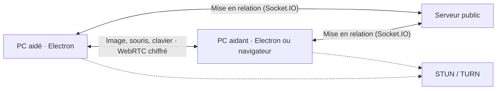

<p align="center"></p>

<h1 align="center">Madrador Remote</h1>

<p align="center">
  <b>Aidez un ami à distance, en voyant et en contrôlant son PC, sans limite de durée.</b><br>
  Gratuit · Windows 10/11 · Chaque connexion doit être acceptée.
</p>

<p align="center">
  <a href="https://github.com/Madrador60/partager-son-ecran/releases/latest"></a>
  <a href="https://github.com/Madrador60/partager-son-ecran/actions/workflows/ci.yml"></a>
  
</p>

<p align="center">
  <a href="https://github.com/Madrador60/partager-son-ecran/releases/latest"><b>⬇ Télécharger pour Windows</b></a> ·
  <a href="https://madrador60.github.io/partager-son-ecran/">Site web</a> ·
  <a href="https://madrador60.github.io/partager-son-ecran/remote.html">Se connecter depuis le navigateur</a>
</p>

---

## Pourquoi Madrador Remote ?

Les outils d’assistance gratuits limitent souvent la durée des sessions. Madrador Remote a été conçu pour **dépanner ses proches sans chronomètre** : la session dure tant que l’un des deux ne l’arrête pas.

- **Sans limite de durée** : la session reste ouverte tant que personne ne l’arrête.
- **Sans compte** : un code à 9 chiffres suffit.
- **Toujours consenti** : rien ne se passe sans un clic « Accepter » sur le PC partagé, et chacun peut tout arrêter à tout moment.
- **Direct et chiffré** : l’image et le contrôle passent directement entre les deux PC (WebRTC chiffré) ; le serveur sert uniquement à les mettre en relation.

## Comment ça marche

| Votre ami (il reçoit l’aide) | Vous (vous l’aidez) |
| --- | --- |
| 1. Installe Madrador Remote et l’ouvre. | 1. Ouvrez Madrador Remote. |
| 2. Dans **Recevoir de l’aide**, choisit son écran et ce que vous pourrez faire. | |
| 3. Clique sur **Générer mon code** et vous envoie les 9 chiffres. | 2. Dans **Aider quelqu’un**, saisissez ce code. |
| 4. Clique sur **Accepter**. | 3. Vous voyez et contrôlez son écran. |

Pour reprendre la main, il suffit d’un clic sur **Arrêter le partage** (ou de retirer une autorisation en direct).

## Fonctionnalités

**Pendant que vous aidez**
- contrôle souris et clavier : raccourcis, accents, AltGr, touches F1-F24 ;
- menu **Touches** pour envoyer ce que votre propre PC intercepterait : touche Windows, Alt+Tab, Ctrl+Maj+Échap, Win+D, Win+E, Win+L, Alt+F4 ;
- contrôle suspendable d’un clic ;
- affichage ajusté ou zoom de 25 à 250 %, plein écran ;
- discussion, presse-papiers texte, envoi de fichiers jusqu’à 25 Mo ;
- statistiques en direct : latence, débit, images/s, liaison directe ou par relais.

**Pour la personne aidée**
- choix d’un écran entier ou d’une seule fenêtre, avec aperçu ;
- autorisations séparées (souris et clavier, presse-papiers, fichiers), choisies au moment d’accepter et modifiables pendant la session ;
- aperçu de ce qui est partagé et nom de l’ordinateur connecté ;
- mode **Indisponible** pour refuser toute demande ;
- arrêt immédiat depuis l’application ou l’icône de la zone de notification.

**Application**
- qualité d’image : *Netteté* (texte lisible), *Fluidité* (vidéo) ou *Économie* (4G) ;
- thème clair ou sombre, notifications Windows, lancement au démarrage ;
- reprise automatique après une coupure réseau ;
- mises à jour automatiques vérifiées (SHA-512 et SHA-256).

## Depuis un navigateur

La page [Se connecter depuis le navigateur](https://madrador60.github.io/partager-son-ecran/remote.html) permet de rejoindre ou de partager une session sans rien installer.

| | Application Windows | Navigateur |
| --- | :---: | :---: |
| Voir un écran distant | ✅ | ✅ |
| Contrôler un PC distant | ✅ | ✅ |
| Partager son écran | ✅ | ✅ |
| Être contrôlé (souris et clavier) | ✅ | ❌ (limite des navigateurs) |
| Touches système (Win, Alt+Tab…) | ✅ | Partiel |

Pour être **dépanné**, la personne aidée a donc besoin de l’application Windows.

## Sécurité et vie privée

- Aucune connexion silencieuse : chaque demande s’affiche et doit être acceptée.
- Le code change à chaque partage. Il peut aussi expirer après 15 min, 1 h ou 8 h si vous le choisissez.
- Le serveur ne voit ni l’image, ni les frappes, ni les fichiers transférés directement entre les deux PC.
- L’historique et les codes récents restent uniquement sur votre ordinateur.
- Electron est isolé (sandbox, `contextIsolation`, aucune API Node dans l’interface), toutes les commandes reçues sont validées, et le contrôle est coupé dès la fin de la session.

N’acceptez une connexion que si vous connaissez la personne. Signalez une faille via [SECURITY.md](SECURITY.md).

## Dépannage

| Problème | Solution |
| --- | --- |
| « Mode local » affiché | Paramètres › Serveur de connexion : l’adresse du serveur public doit être la même sur les deux PC. |
| Le premier essai met une minute | Le serveur gratuit sortait de veille ; réessayez. |
| Code refusé | Générez un nouveau code ; vérifiez qu’il n’a pas expiré. |
| L’écran reste noir | La connexion directe est bloquée (4G, box stricte) : un relais TURN est nécessaire, voir [DEPLOYMENT.md](DEPLOYMENT.md). |
| Le contrôle ne répond pas | Vérifiez que « Souris et clavier » est autorisé et que le bouton **Contrôle** est actif. Certaines fenêtres administrateur refusent le contrôle d’un programme non administrateur. |
| Avertissement SmartScreen | L’installeur n’est pas encore signé : *Informations complémentaires › Exécuter quand même*. |

---

## Pour les développeurs

### Architecture



| Dossier | Rôle |
| --- | --- |
| `main.js`, `preload.js` | Processus principal Electron : capture, contrôle (nut-js), zone de notification, mises à jour |
| `public/` | Interface de l’application |
| `server/`, `src/server/` | Serveur de mise en relation, sessions (mémoire ou Redis), identifiants TURN |
| `src/main/` | Serveur intégré, IPC sécurisé, traduction clavier et souris |
| `website/` | Site public et viewer navigateur (`/remote`) |
| `scripts/`, `tests/` | Tests, contrôles de sécurité, diagnostic, tests e2e Playwright |

Plus de détails : [ARCHITECTURE.md](ARCHITECTURE.md), [AUDIT.md](AUDIT.md), [ROADMAP.md](ROADMAP.md).

### Lancer en local

Prérequis : Node.js 22 et Windows 10/11.

```powershell
npm install
npm start
```

L’application démarre son propre serveur sur `127.0.0.1:3000`, ce qui suffit pour tester sur un seul PC. Le site seul se lance avec `npm run server`, ou avec `LANCER-LE-SITE.bat`.

### Tests

```powershell
npm run verify      # syntaxe, serveur, sessions, clavier, sécurité
npm run test:e2e    # site et viewer dans Chromium
npm run build       # installeur NSIS dans dist/
```

### Serveur public

Pour relier deux réseaux différents, les deux applications doivent partager un serveur public. Le fichier [`render.yaml`](render.yaml) le déploie gratuitement sur Render. Le guide pas à pas, avec le relais TURN, est dans [DEPLOYMENT.md](DEPLOYMENT.md).

| Variable | Rôle |
| --- | --- |
| `PUBLIC_ORIGIN` | Origine HTTPS du site autorisée (obligatoire en production) |
| `MADRADOR_TURN_URL`, `_USERNAME`, `_CREDENTIAL` | Relais TURN |
| `MADRADOR_TURN_MODE` | `static` (service hébergé) ou `hmac` (Coturn, identifiants temporaires) |
| `REDIS_URL` | Sessions partagées entre plusieurs instances (facultatif) |
| `RECONNECT_GRACE_MS`, `MAX_FILE_MB` | Délai de reprise, taille maximale des fichiers |

La variable GitHub `MADRADOR_SIGNAL_URL` est intégrée à l’installeur au moment de la Release, et le site l’utilise aussi.

### Publier une version

```powershell
npm version 6.3.0 --no-git-tag-version   # puis commit sur main
git tag v6.3.0
git push origin v6.3.0
```

Le workflow **Release** exécute les tests, intègre l’adresse du serveur public, construit l’installeur, publie `latest.yml`, le blockmap et le SHA-256, puis vérifie la Release. Les applications installées proposent ensuite la mise à jour. `PUBLIER-UNE-VERSION.bat` automatise ces étapes sous Windows.

La signature Authenticode est facultative : renseignez les secrets `WIN_CSC_LINK` et `WIN_CSC_KEY_PASSWORD` pour supprimer l’avertissement SmartScreen.

### Limites connues

- Pas encore d’accès sans surveillance : quelqu’un doit accepter sur le PC aidé.
- Transfert de fichiers sans reprise, limité à 25 Mo.
- Audio système non partagé.
- Installeur non signé.
- Aucune licence open source n’est accordée tant qu’un fichier `LICENSE` n’a pas été ajouté.

Les contributions sont les bienvenues : voir [CONTRIBUTING.md](CONTRIBUTING.md).
